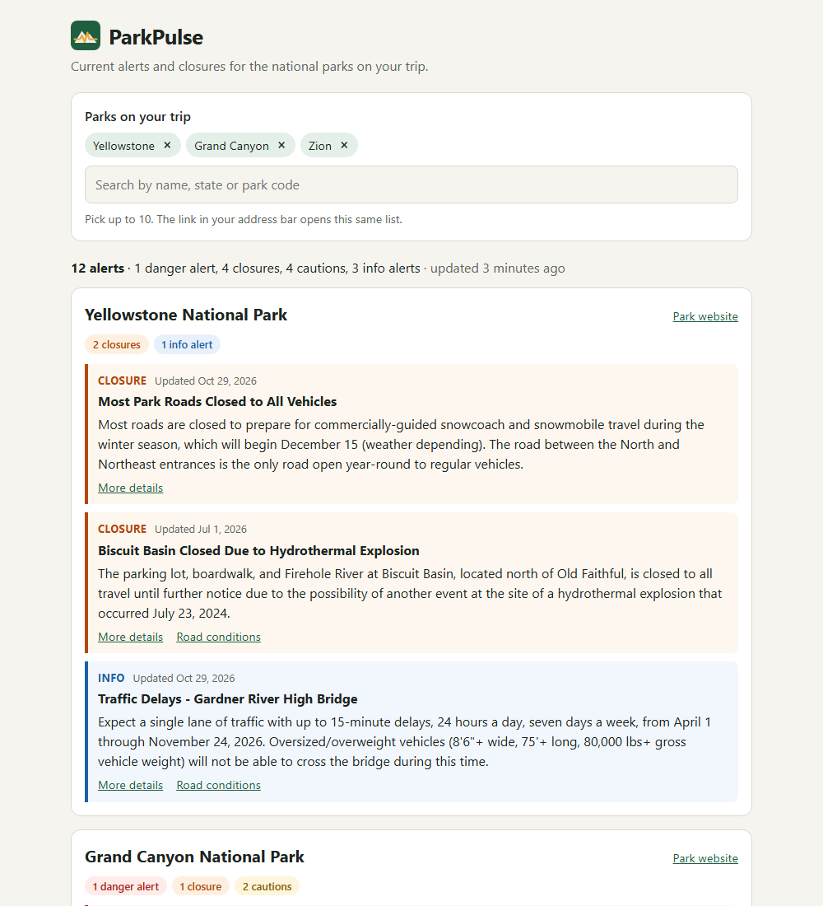

# ParkPulse

[](https://github.com/Khalick/parkpulse/actions/workflows/ci.yml)

One page with the current alerts and closures for the national parks you're planning to visit.

Checking road closures and warnings before a trip means opening each park's page one by one. ParkPulse pulls them together from the National Park Service API, puts the most serious ones first, and gives you a link you can share with the people you're traveling with.



## What it does today

- **Park picker.** Search all 475 NPS sites by name, state (`UT`) or park code (`yell`). Works with the keyboard (arrows, Enter, Escape, Backspace) and follows the ARIA combobox pattern.
- **Alerts for every park you pick**, most serious first: danger, closures, cautions, then information. Each one shows when the park service last updated it, and alerts that haven't been updated in over a year are marked, since some date back to 2015.
- **Shareable trips.** The parks you pick go into the address bar (`/?parks=yell,grca,zion`), and ParkPulse remembers them for your next visit.
- **Still useful when the NPS API isn't.** If the park service stops answering, ParkPulse shows the last alerts it has and says how old they are.
- Works on phones and in dark mode.

## How it works

```
browser ──/api──▶ ParkPulse server (Express) ──X-Api-Key──▶ developer.nps.gov
                  - park list cached 24 hours
                  - all current alerts cached 10 minutes
```

- The NPS API key stays on the server. It's sent in a request header, never in a URL, so it doesn't end up in logs.
- Instead of asking the NPS API for each visitor's parks, the server fetches **every current alert in one request** (about 600 alerts, 330 KB) and picks out each visitor's parks itself. So it makes about 6 alert requests an hour however many people use it, well under the key's limit of 1,000 an hour.
- The API answers a park code that doesn't exist with an empty list rather than an error, so the server checks codes against the real park list and returns a clear error instead.

## Running it locally

You need [Node.js](https://nodejs.org) 22.22 or newer and a free NPS API key from https://www.nps.gov/subjects/developer/get-started.htm. To try it before signing up, `DEMO_KEY` works, but only for about 10 requests an hour.

```bash
git clone https://github.com/Khalick/parkpulse.git
cd parkpulse
npm install
cp .env.example .env   # then put your key in .env

# terminal 1: the API server, on http://localhost:3001
npm run dev:server

# terminal 2: the app, on http://localhost:5173
npm run dev:client
```

To run it the way it would run on a host, as one server for the app and the API:

```bash
npm run build
npm start              # http://localhost:3001
```

## Tests

```bash
npm test
```

130 tests: 85 for the server (Node's built-in test runner) and 45 for the app (Vitest and Testing Library). The server tests use real NPS responses recorded in [server/tests/fixtures](server/tests/fixtures), so they need no network and no key. GitHub Actions runs them on Node 22, 24 and 26 for every push.

## API

| Request | Returns |
| --- | --- |
| `GET /api/parks` | `{ fetchedAt, stale, parks: [{ code, name, fullName, designation, states, latitude, longitude, url }] }` |
| `GET /api/alerts?parks=yell,zion` | `{ fetchedAt, stale, parks: [{ code, name, fullName, url, alerts: [{ id, title, description, category, url, lastUpdated, roadEvents }] }] }` |
| `GET /api/health` | `{ ok: true }` |

`/api/alerts` takes up to 10 park codes. Errors come back as `{ error: "message" }`, with status 400 for a bad request, 502 or 504 when the NPS API fails, and 503 with a `Retry-After` header when the key's hourly limit is used up.

## Project layout

```
client/   React app (Vite)
server/   Express server: NPS client, caching, API routes
docs/     screenshot for this README
```

## Plans

See [ROADMAP.md](ROADMAP.md). Next up: campground status, deploying a live version, and filtering alerts by trip dates.

## Data

Park and alert data comes from the [National Park Service Data API](https://www.nps.gov/subjects/developer/). ParkPulse is not an official NPS product. Always check nps.gov before you travel.

## License

MIT, see [LICENSE](LICENSE).
